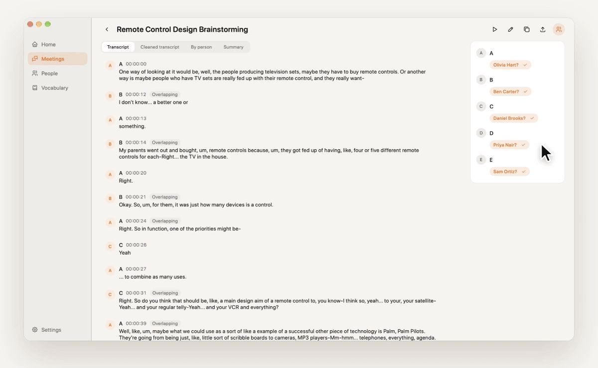
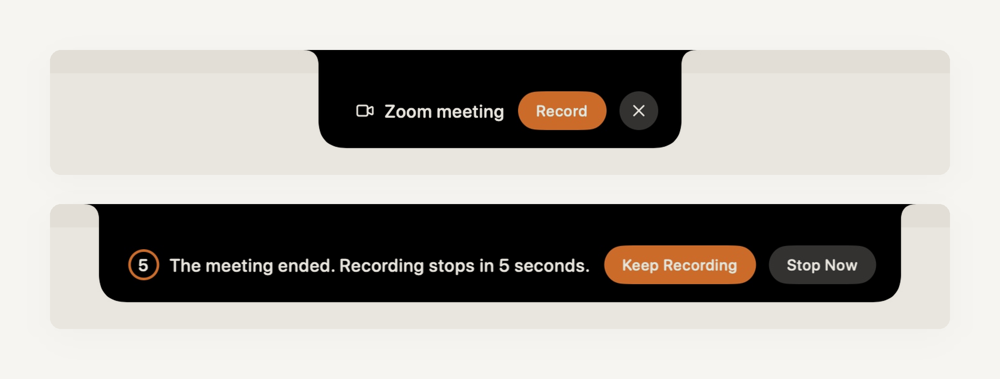
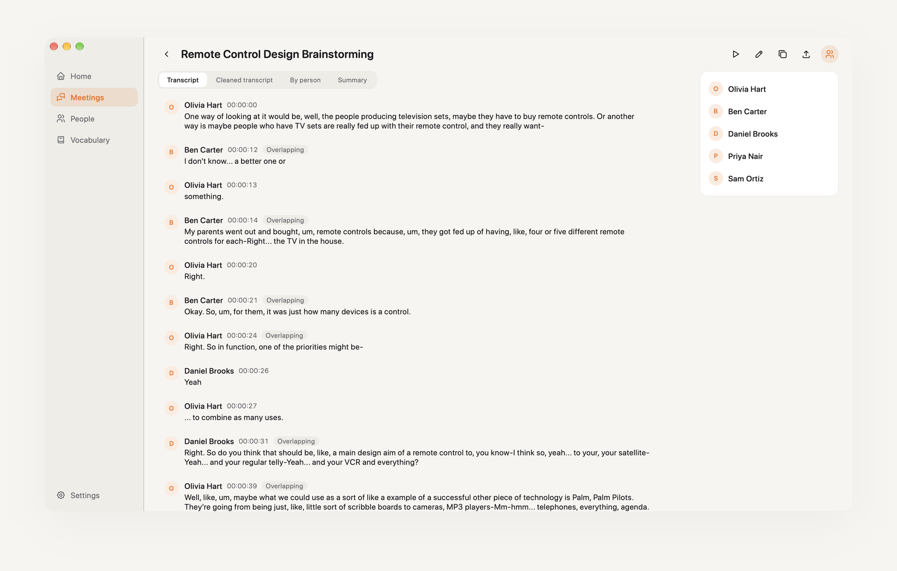
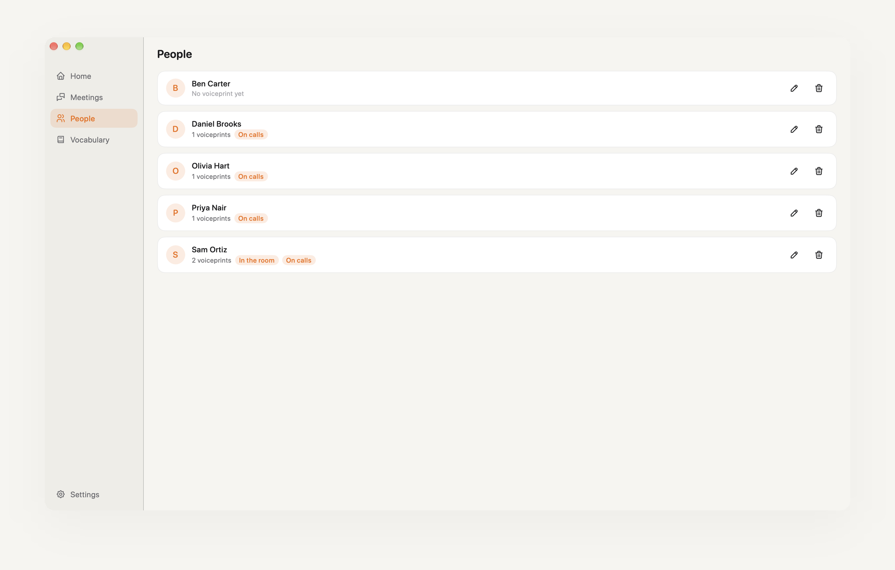
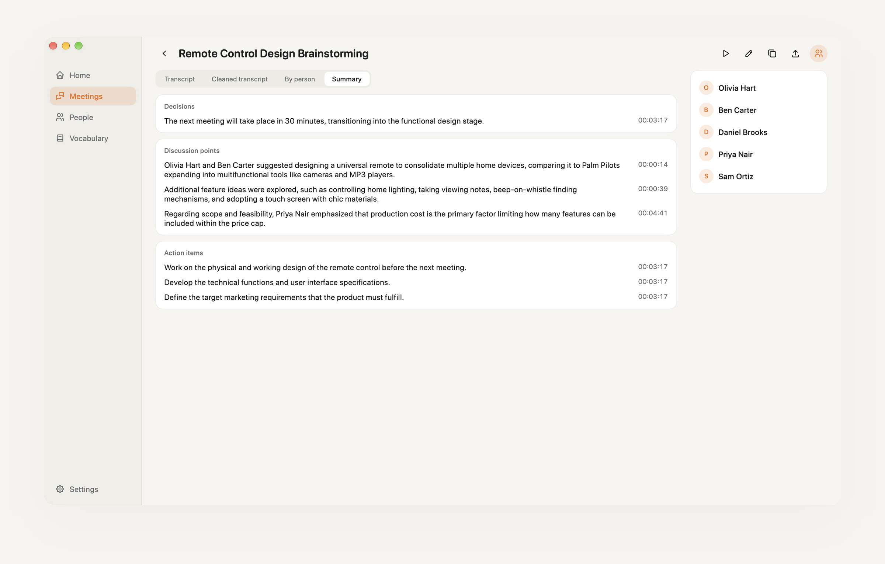
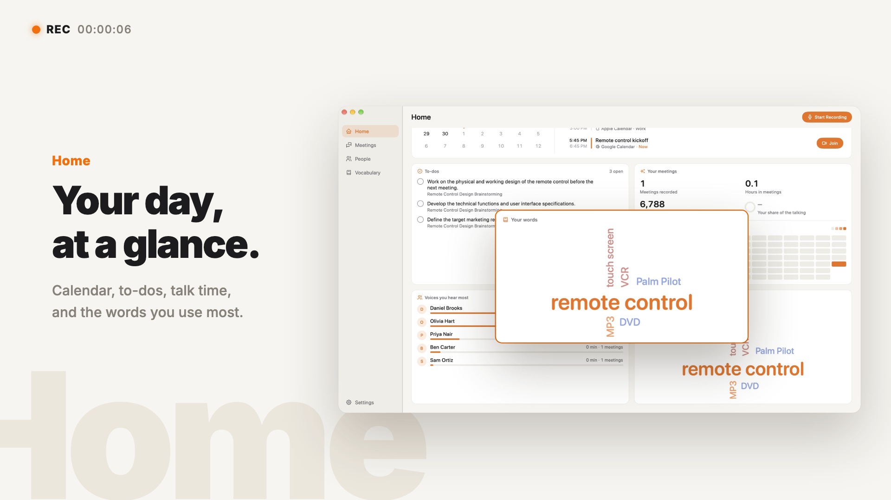

  

  <h1>mm2t</h1>

  
<a href="README.md">English</a> · <a href="README.zh-TW.md">繁體中文</a>

  
<strong>Focus on the conversation. Let mm2t take the notes.</strong>

  
A meeting recorder that lives in your Mac's menu bar. It detects meetings, records them, and turns them into speaker-labeled transcripts and summaries.

  

    <a href="https://github.com/yuzen9622/mm2t/releases/latest"><strong>Download mm2t</strong></a>
    &nbsp;·&nbsp; macOS 14.2 or later &nbsp;·&nbsp; Free and open source
  

  

## No extra guests in your meeting

mm2t records directly on your Mac. No bot joins the meeting, and no screen video is recorded. It supports Google Meet, Microsoft Teams, Zoom, and Webex. When a meeting starts, a prompt at the top of your screen asks whether to record; when it ends, recording stops automatically after a short countdown.

All mm2t windows stay out of your screen share, so you can present without worrying about them showing up.

  

## Know who said every word

Your microphone and the other side of the call are recorded on separate tracks. Speaker identification then runs locally on your Mac. Name a speaker once, and mm2t remembers their voiceprint and labels them automatically in future meetings.

  

Everyone's voiceprints live on the People page, with separate profiles for how they sound in a meeting room and on a call.

  

## Meeting over. Notes ready.

Every meeting produces four views:

| | |
| --- | --- |
| Transcript | In chronological order, with speaker labels |
| Cleaned transcript | Filler words and verbal tics removed for easier reading |
| By person | The key points each person made |
| Summary | Decisions, discussion points, and action items, each with a timestamp |

  

All your meetings appear in one chronological list, searchable by title, content, or participant.

## Your data stays on your Mac

Recordings, voiceprints, and meeting notes are stored locally. mm2t has no servers of its own. Transcription and summaries use your own API keys (ElevenLabs and Google Gemini), with usage billed directly to your accounts. You can also use a self-hosted transcription server to keep audio entirely on your own devices. See the [Privacy Policy](PRIVACY.md) for details.

## mm2t in a minute

  

[Watch the English demo](docs/assets/video/mm2t-en.mp4)

## Installation

Requires macOS 14.2 or later (the minimum version for Core Audio Process Tap).

1. Download `mm2t-X.Y.Z.dmg` from [GitHub Releases](https://github.com/yuzen9622/mm2t/releases/latest).
2. Open the DMG and drag `mm2t.app` into Applications.
3. Open mm2t from Applications.

The current release is not yet Developer ID signed or notarized by Apple, so macOS will block it the first time you open it. Control-click `mm2t.app` in Applications and choose **Open**. If there is no Open option, go to **System Settings > Privacy & Security** and click **Open Anyway**. Each release page includes the full steps.

The current release does not update automatically. Visit [GitHub Releases](https://github.com/yuzen9622/mm2t/releases) to download new versions.

## First launch: grant permissions

On first launch, a setup wizard explains what each permission is used for. You can return to it later through **Setup Wizard…** in the menu bar menu. All permissions are managed in **System Settings > Privacy & Security**.

| Permission | Purpose | Without it |
| --- | --- | --- |
| Microphone | Records your own audio track | Recording is unavailable |
| System Audio Recording | Records only the meeting app's audio as the remote track | The remote track is silent |
| Accessibility | Reads the foreground window's title to detect meetings | Recording must be started manually |
| Automation (per browser) | Reads the current browser tab's URL to detect web meetings | Web meetings such as Google Meet cannot be detected |

If a permission is denied, the setup wizard explains why it is needed and provides a button to open System Settings.

For Google Meet, mm2t captures audio from the entire browser. Avoid playing other audio in the same browser during a meeting, or it will be recorded too.

## Set up API keys

Nothing is routed through mm2t-operated servers. You supply your own keys, and usage is billed directly to your accounts. Keys are stored in macOS Keychain, never written to disk in plain text. Enter your keys under **Settings** in the main window and click **Save**. mm2t makes a test request to check that each key works.

- **ElevenLabs** (speech to text): Create an API key at [ElevenLabs](https://elevenlabs.io/app/settings/api-keys) with Speech to Text permission and sufficient credits. Key validation sends 0.5 seconds of silence at a minimal cost.
- **Google Gemini** (name suggestions, cleaned transcripts, per-person notes, and summaries): Create an API key at [Google AI Studio](https://aistudio.google.com/apikey). **Use a key with paid billing enabled.** Under the [Gemini API Terms](https://ai.google.dev/gemini-api/terms), content sent through the free tier may be used by Google to improve its products; content sent through the paid tier is not.

See the [Privacy Policy](PRIVACY.md) for details on where each type of data is sent.

## Self-hosted transcription server

If you have a machine with an NVIDIA GPU, you can host your own transcription server. Audio travels only between your own machines, and there are no speech-to-text API fees. The server runs Breeze-ASR-25 through faster-whisper, tuned for Taiwanese Mandarin and mixed Chinese-English speech, and is available as a Docker image.

See [server/README.md](server/README.md) for deployment instructions. Once it is running, enter the server URL in mm2t's settings (for example, a Tailscale address such as `http://gpu.tailnet:8000`). If you configured `MM2T_SERVER_TOKEN`, enter that token as well. You can set the priority order of transcription sources: if your server is unreachable, mm2t tries the next source and shows which one was used in the results.

## License

mm2t is licensed under the [GNU Affero General Public License v3.0](LICENSE). Third-party software and models are listed in [THIRD_PARTY_NOTICES.md](THIRD_PARTY_NOTICES.md).

Please read the [Privacy Policy](PRIVACY.md) and [Terms of Use](TERMS.md) before using mm2t.
