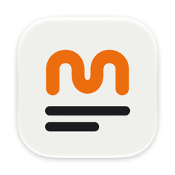
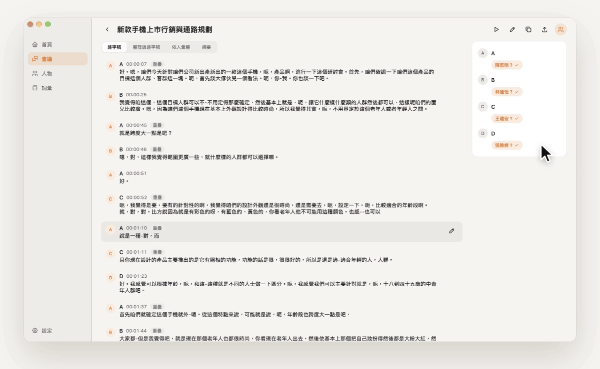
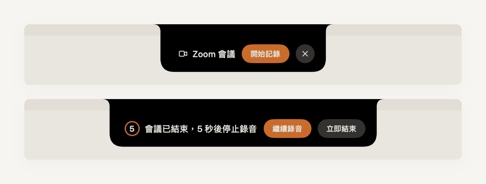
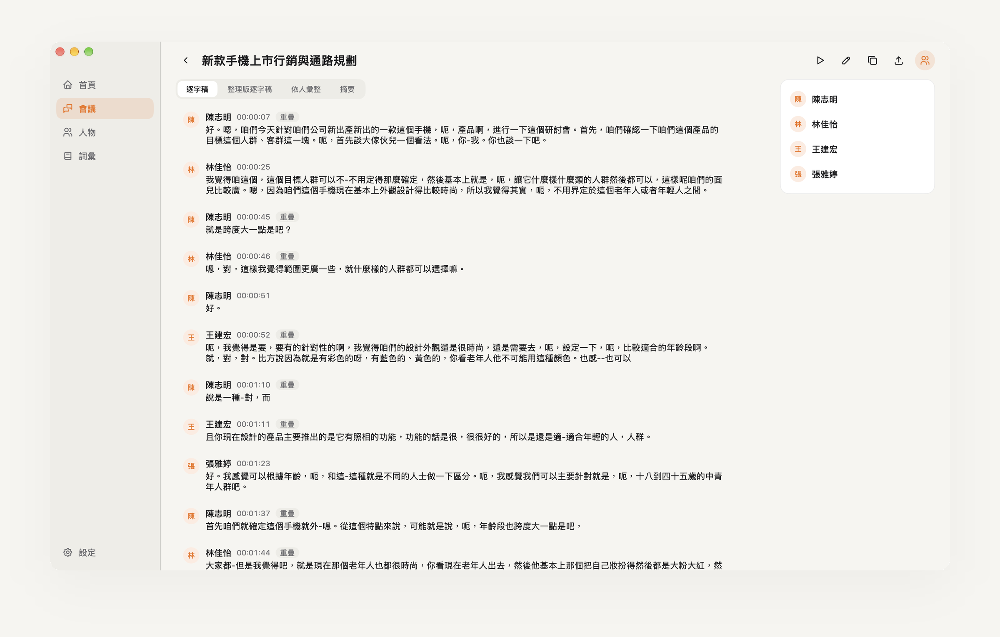
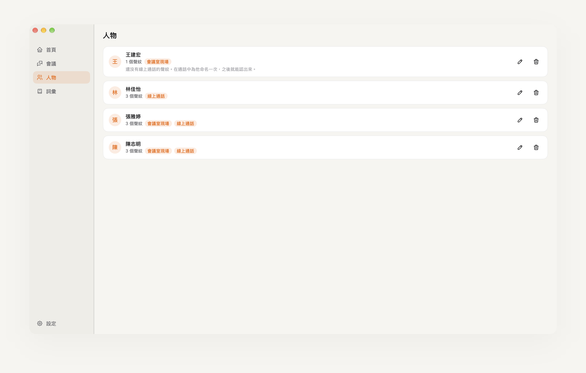
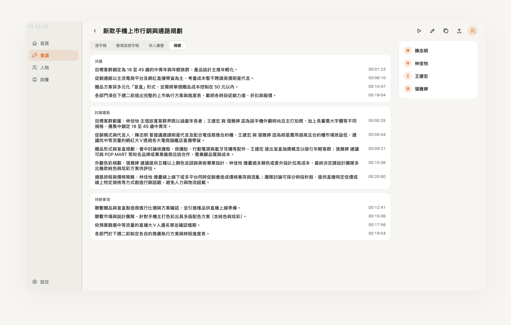
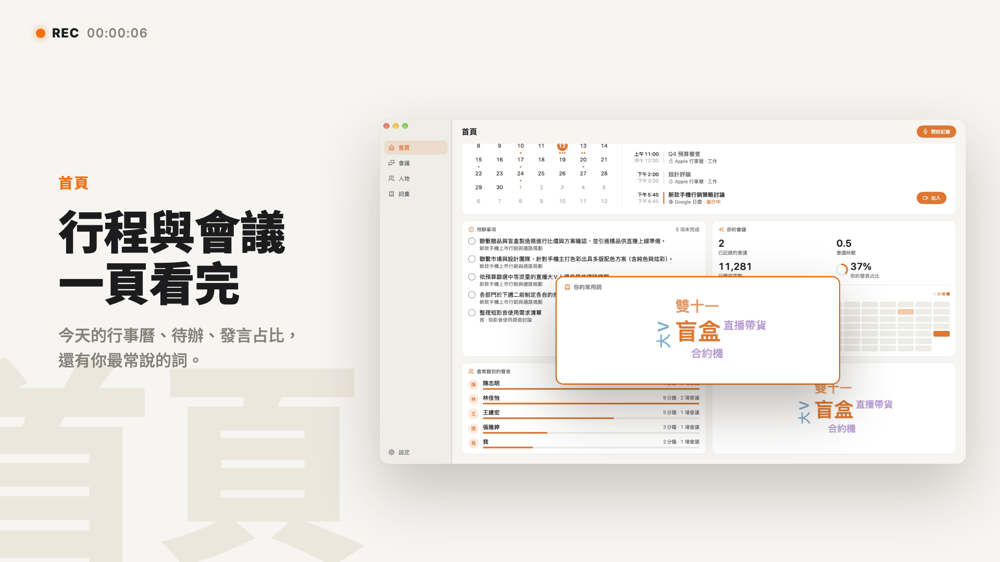

  

  <h1>mm2t</h1>

  
<a href="README.md">English</a> · <a href="README.zh-TW.md">繁體中文</a>

  
<strong>開會時專心說話，紀錄交給 mm2t。</strong>

  
常駐 Mac 選單列的會議記錄工具。偵測到會議就開始錄音，會後產出分好說話者的逐字稿與摘要。

  

    <a href="https://github.com/yuzen9622/mm2t/releases/latest"><strong>下載 mm2t</strong></a>
    &nbsp;·&nbsp; macOS 14.2 以上 &nbsp;·&nbsp; 免費、開放原始碼
  

  

## 不需要邀請任何人進會議

mm2t 直接在你的 Mac 上錄音，不會有 Bot 加入會議，也不錄畫面。支援 Google Meet、Microsoft Teams、Zoom 與 Webex，會議一開始，螢幕頂端就會詢問要不要記錄；會議結束後倒數幾秒自動停止。

mm2t 的所有視窗都不會出現在螢幕分享畫面裡，分享簡報時不用擔心被看到。

  

## 知道每一句話是誰說的

你的麥克風和會議另一端的聲音分成兩條音軌錄製，再由 Mac 本機辨識不同的說話者。替說話者命名一次，mm2t 會記住他的聲紋，下次開會自動標上名字。

  

每個人的聲紋都存在「人物」頁，會分別記住他在會議室現場和線上通話時的聲音。

  

## 會議結束，紀錄就整理好了

每場會議會產出四種內容：

| | |
| --- | --- |
| 逐字稿 | 依時間排列，標示說話者 |
| 整理版逐字稿 | 去掉贅字與口頭禪，方便閱讀 |
| 依人彙整 | 每個人說了哪些重點 |
| 摘要 | 決議、討論重點與待辦事項，每一條都附上時間點 |

  

所有會議依時間排列在同一個清單，可以用標題、內容或與會者搜尋。

## 資料留在你的 Mac

錄音、聲紋與會議紀錄都只存在本機，mm2t 沒有自己的伺服器。語音轉文字與摘要使用你自己的 API 金鑰（ElevenLabs、Google Gemini），費用直接由你的帳號支付；也可以改用自架的轉錄伺服器，讓音訊完全不離開你的設備。詳見 [隱私權政策](PRIVACY.md)。

## 一分鐘看懂 mm2t

  

https://github.com/user-attachments/assets/9b72ccfb-d3c0-4535-afa1-5475223d5fee

## 安裝

需求：macOS 14.2 以上（Core Audio Process Tap 的最低版本）。

1. 到 [GitHub Releases](https://github.com/yuzen9622/mm2t/releases/latest) 下載 `mm2t-X.Y.Z.dmg`。
2. 打開 DMG，把 `mm2t.app` 拖到「應用程式」資料夾。
3. 從「應用程式」打開 mm2t。

目前的版本還沒有 Developer ID 簽章與 Apple 公證，第一次打開時 macOS 會擋下來：在「應用程式」中按住 Control 點一下 `mm2t.app` 選 **打開**；若沒有「打開」選項，到 **系統設定 > 隱私權與安全性** 按 **仍要打開**。每個 Release 頁面都有完整步驟。

目前的版本不會自動更新，有新版時請回 [GitHub Releases](https://github.com/yuzen9622/mm2t/releases) 下載。

## 第一次使用：授予權限

第一次打開時會出現設定精靈，逐一說明每個權限的用途。之後可以從選單列選單的 **設定精靈⋯** 回到這個視窗。所有權限都在 **系統設定 > 隱私權與安全性** 裡管理。

| 權限 | 用途 | 沒有的話 |
| --- | --- | --- |
| 麥克風 | 錄下「我」的音軌 | 無法錄音 |
| 系統音訊錄製 | 只錄會議 App 播放的聲音，作為「遠端」音軌 | 遠端音軌是靜音 |
| 輔助使用 | 讀取前景視窗標題，判斷是否在開會 | 只能手動開始錄音 |
| 自動化（各瀏覽器） | 讀取瀏覽器目前分頁的網址，偵測網頁版會議 | 無法偵測 Google Meet 等網頁版會議 |

權限被拒絕時，設定精靈會說明原因，並提供打開系統設定的按鈕。

錄 Google Meet 時，mm2t 擷取的是整個瀏覽器的聲音。開會時不要在同一個瀏覽器播放其他聲音，否則會一起被錄進去。

## 設定 API 金鑰

mm2t 不經過任何 mm2t 自己的伺服器。你填入自己的金鑰，費用由你的帳號直接支付。金鑰存在 macOS 鑰匙圈，不會以明文寫進磁碟。在主視窗的 **設定** 填入金鑰並按 **儲存**，mm2t 會先試用一次，確認金鑰可用。

- **ElevenLabs**（語音轉文字）：到 [ElevenLabs](https://elevenlabs.io/app/settings/api-keys) 建立 API 金鑰，需要有 Speech to Text 權限和足夠額度。驗證金鑰時會送出 0.5 秒的靜音，花費極少。
- **Google Gemini**（名字推測、整理版逐字稿、依人彙整、摘要）：到 [Google AI Studio](https://aistudio.google.com/apikey) 建立 API 金鑰。**請使用已啟用付費方案的金鑰。** 依 [Gemini API 條款](https://ai.google.dev/gemini-api/terms)，免費方案送出的內容可能被 Google 用來改進產品，付費方案則不會。

每種資料送到哪裡，請見 [隱私權政策](PRIVACY.md)。

## 自架轉錄伺服器

如果你有 NVIDIA GPU 主機，可以自架轉錄伺服器，讓音訊只在你自己的機器之間傳輸，也不用付語音轉文字的 API 費用。伺服器用 faster-whisper 執行 Breeze-ASR-25（針對台灣華語與中英夾雜），提供 Docker image。

部署方式見 [server/README.md](server/README.md)。部署好之後，在 mm2t 的設定裡填入伺服器網址（例如 Tailscale 網址 `http://gpu.tailnet:8000`），有設定 `MM2T_SERVER_TOKEN` 的話一併填入權杖。轉錄來源可以排順序：自架伺服器連不上時，mm2t 會改用下一個來源，並在結果中標示實際使用的來源。

## 授權

mm2t 以 [GNU Affero General Public License v3.0](LICENSE) 授權。使用的第三方軟體與模型列在 [THIRD_PARTY_NOTICES.md](THIRD_PARTY_NOTICES.md)。

使用前請閱讀 [隱私權政策](PRIVACY.md) 與 [使用條款](TERMS.md)。
